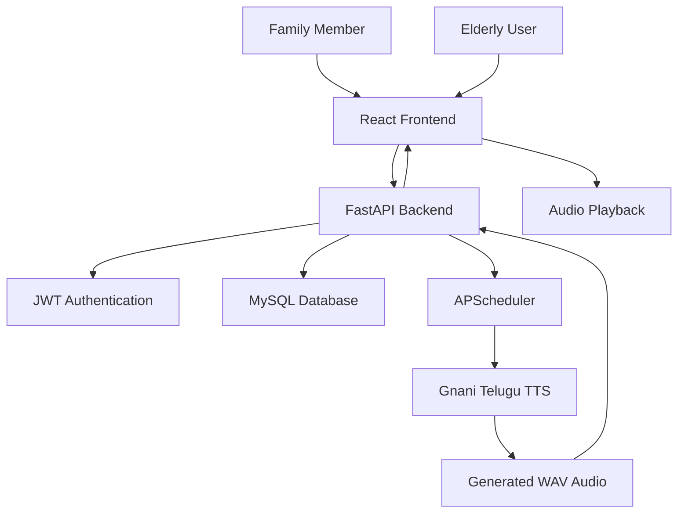

# Apno Ki Awaaz 🔊
### Your Family's Voice, Their Everyday Companion.

**Apno Ki Awaaz** is a family-assisted voice reminder application designed to help elderly people stay connected with their daily routines through personalized voice reminders in their native language.

The platform allows family members to create and schedule reminders that are converted into Telugu voice messages using AI-powered Text-to-Speech (TTS). Elderly users can access and listen to these reminders through a simple, accessible interface.

---

## 🌟 The Problem

Many elderly people struggle to remember daily activities such as taking medicines, attending appointments, and following regular routines. Traditional reminder applications often rely on text notifications, which may not be convenient for everyone.

Family members also need a simple way to remind and support their loved ones, especially when they are not physically present.

## 💡 Our Solution

Apno Ki Awaaz bridges this gap by turning family-written reminders into personalized voice messages.

Family members can schedule reminders, while elderly users can listen to them in their preferred language. The application focuses on simplicity, accessibility, and family involvement.

## ✨ Key Features

### 👨‍👩‍👧 Family Dashboard
- Register and securely log in as a family member.
- Request permission to connect with an elderly user's account.
- Create and schedule personalized reminders.
- Configure one-time, daily, and weekly reminders.
- Track reminder generation and status.

### 👵 Elderly Dashboard
- Simple, accessible interface with clear controls.
- Review and approve or reject family connection requests.
- View scheduled reminders.
- Listen to generated Telugu voice reminders.
- Mark reminders as completed.

### 🗣️ AI-Powered Voice Generation
- Converts written reminders into speech.
- Integrates Gnani Vachana TTS.
- Supports personalized voice generation using a configured voice embedding.
- Stores generated audio for authenticated retrieval.

### 🔐 Security and Consent
- JWT-based authentication.
- Role-based access for FAMILY and ELDERLY users.
- Explicit consent before family members can manage reminders.
- Protected reminder and audio access.

### ⚙️ Automated Reminder Processing
- Background scheduling using APScheduler.
- Automatic processing of due reminders.
- Audio generation and status tracking.
- Retry handling for failed generation attempts.

---

## 🏗️ System Architecture



---

## 🛠️ Technology Stack

| Layer | Technologies |
|---|---|
| Frontend | React, Vite, TypeScript |
| Backend | Python, FastAPI |
| Database | MySQL, SQLAlchemy |
| Authentication | JWT, Argon2 |
| Scheduling | APScheduler |
| Voice Generation | Gnani Vachana TTS |
| API Communication | REST APIs |
| Testing | Pytest, Vitest |

---

## 📂 Project Structure

```text
apno-ki-awaaz/
│
├── backend/
│   ├── app/
│   │   ├── main.py
│   │   ├── models/
│   │   ├── routes/
│   │   ├── services/
│   │   └── ...
│   ├── tests/
│   ├── migrations/
│   ├── requirements.txt
│   └── .env.example
│
├── frontend/
│   ├── src/
│   ├── public/
│   ├── package.json
│   └── ...
│
├── .gitignore
└── README.md
```

---

## 🚀 Getting Started

### Prerequisites

- Python 3.10+
- Node.js 22+
- MySQL
- Gnani Vachana API credentials

### 1. Clone the repository

```bash
git clone https://github.com/has257/apno-ki-awaaz.git
cd apno-ki-awaaz
```

### 2. Configure the backend

```bash
cd backend
python3.10 -m venv .venv
source .venv/bin/activate
pip install -r requirements.txt
```

Create your local `.env` file using `.env.example`.

Configure the required database connection, JWT secret, and Gnani API credentials. Create the MySQL database before starting the application.

### 3. Start the backend

```bash
python -m uvicorn app.main:app --host 127.0.0.1 --port 8000 --workers 1
```

API documentation:

`http://127.0.0.1:8000/docs`

### 4. Configure and start the frontend

Open another terminal:

```bash
cd frontend
npm install
```

Configure the API base URL using the frontend environment variable:

```env
VITE_API_BASE_URL=http://127.0.0.1:8000
```

Start the development server:

```bash
npm run dev
```

Open:

`http://localhost:5173`

---

## 🧪 Testing

### Backend

```bash
cd backend
./.venv/bin/python -m pytest -q
```

### Frontend

```bash
cd frontend
npm test
npm run build
```

---

## 🔮 Future Enhancements

- Push notifications for scheduled reminders.
- Automatic reminder playback on elderly users' devices.
- Improved multilingual voice support.
- Reminder completion notifications for family members.
- Delivery tracking and reminder history.
- Offline audio access and improved reliability.

---

## 🔒 Security Notes

- Never commit `.env` files, API keys, JWT secrets, database credentials, or voice embeddings.
- Configure your own credentials locally.
- Use HTTPS and secure deployment settings in production.

---

## ❤️ Our Vision

Technology should make people feel closer, not more isolated.

**Apno Ki Awaaz** aims to make everyday care easier by bringing the familiar voices and thoughtful reminders of family members closer to elderly loved ones.

*Because sometimes, hearing a familiar voice is all the support someone needs.*

---

### 👩‍💻 Developed With Care

**Project:** Apno Ki Awaaz  
**GitHub:** [has257/apno-ki-awaaz](https://github.com/has257/apno-ki-awaaz)

